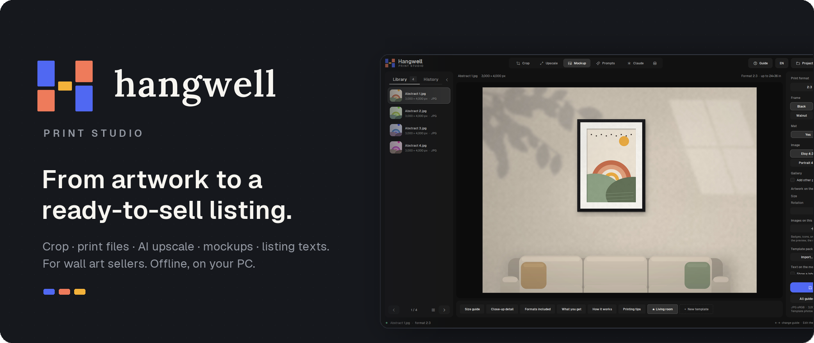
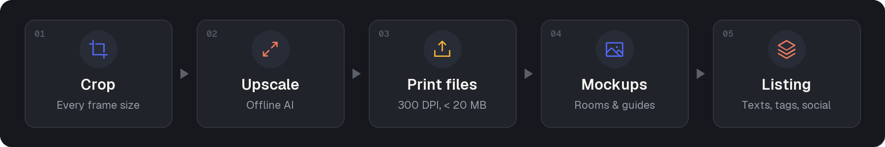
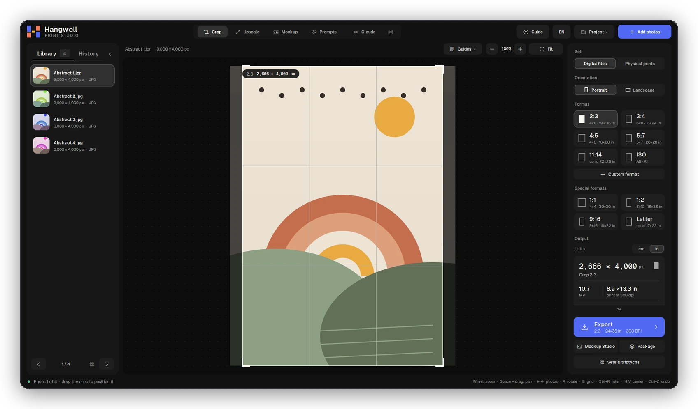
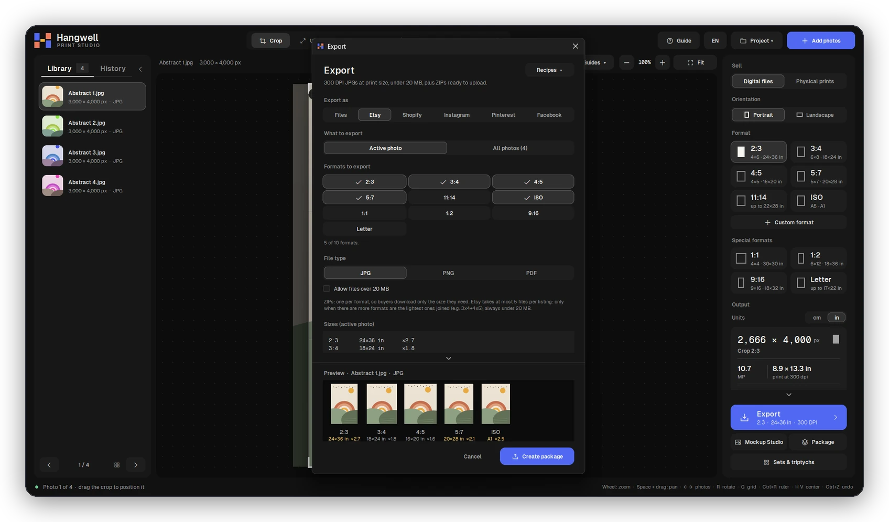
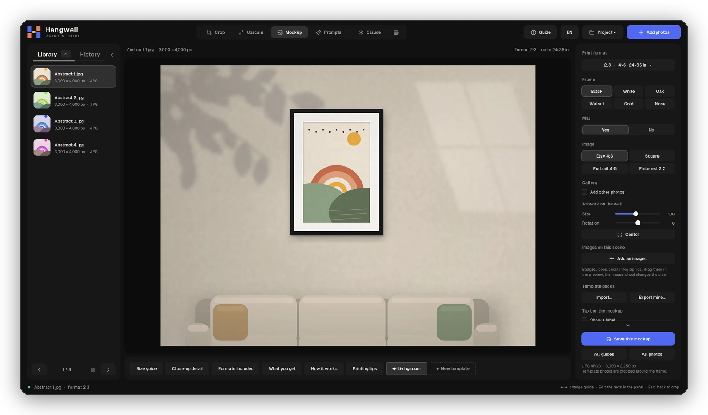
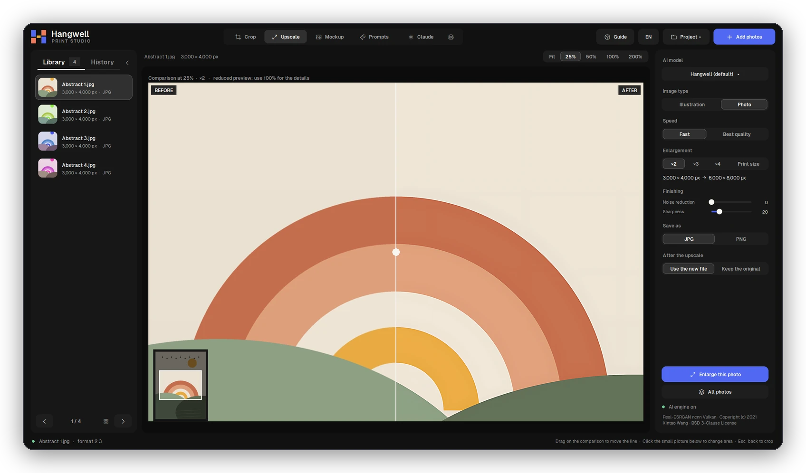
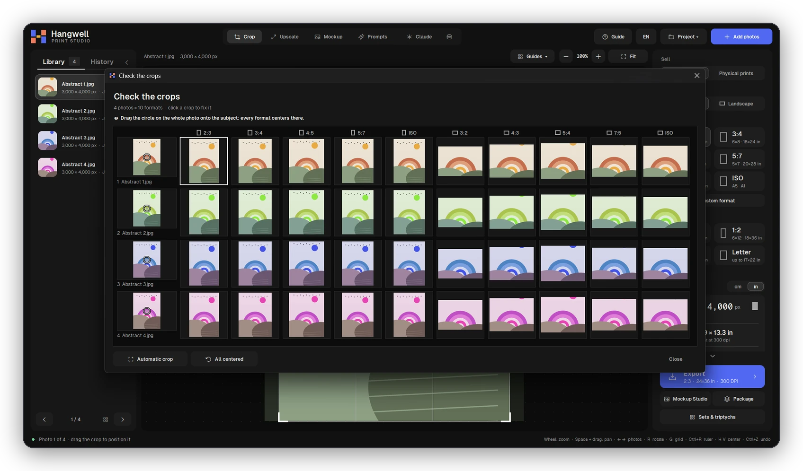
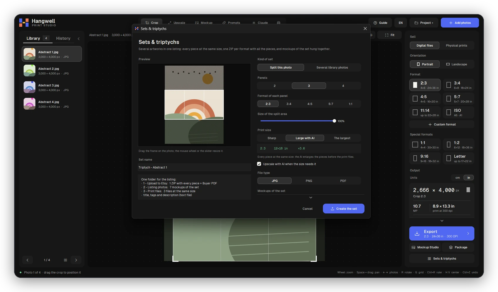
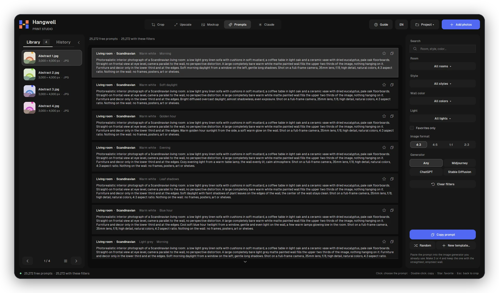

  

  
  
  
  
  

  <b>The print studio for people who sell wall art.</b> 
  Digital downloads on Etsy and Shopify, or physical prints through print-on-demand. 
  One app, from the artwork to the finished listing — and your files never leave your PC.

  <a href="#download"><b>Download</b></a> ·
  <a href="#what-it-does">What it does</a> ·
  <a href="#private-by-design">Privacy</a> ·
  <a href="#faq">FAQ</a> ·
  <a href="#italiano">Italiano</a>

 

  

## Why Hangwell

<table>
  <tr>
    <td width="33%" valign="top">
      <h3>Made for wall art</h3>
      Real frame sizes (2:3, 3:4, 4:5, 5:7, 11:14, ISO A), inches and centimeters, 300 DPI, and Etsy's rules built in: 20 MB per file, 5 files, 20 photos, 13 tags.
    </td>
    <td width="33%" valign="top">
      <h3>One click, whole listing</h3>
      The <b>Listing package</b> upscales when needed, writes the print files, mockups, social images, Shopify CSV, a buyer PDF and the listing texts — one folder per artwork.
    </td>
    <td width="33%" valign="top">
      <h3>Offline and private</h3>
      No account, no cloud, no tracking. Even the AI upscale runs on your own computer. No internet? No ads, and everything still works.
    </td>
  </tr>
</table>

## What it does

### Crop every frame size at once

Open your artwork, pick the sizes you sell and Hangwell crops each one. Every format remembers its own crop, the output panel tells you the print size at 300 DPI, and precision tools (rule of thirds, grid, ruler in cm/in, center snapping) help when it matters.

### Print files that pass Etsy the first time

300 DPI JPGs at print size, each **under 20 MB** (quality lowered only as much as needed), **one ZIP per format** and never more than Etsy's 5 files. PNG or PDF if you prefer. A live preview shows every file and how much it is enlarged, and the quality check warns you before a print comes out blurry.

### Mockups that sell

Hang your artwork in a room, choose frame and mat, build galleries (row, grid, salon) and make the guide images buyers look for: **size guide** with frames next to a sofa, **close-up detail**, *what you get*, *how it works* and *printing tips*. Add your own empty-wall rooms as templates, or share them as `.hangwell` packs.

### AI upscale, on your PC

Too small for 24×36? Enlarge it with **Real-ESRGAN** running locally — for photos or illustrations, fast or best quality, ×2 / ×3 / ×4 or straight to the print size, with a before/after preview. You can even drop in your own upscale model (`.pth`, `.safetensors`, ncnn): Hangwell converts and tests it for you.

### Check a whole collection in one look

Automatic crop finds the most detailed area of every image. Then one grid shows **every photo in every format**: click a crop to fix it, or drag the circle onto the subject and every format centers there.

### Sets and triptychs

Split one image into 2–4 panels or group 2–6 artworks into a single listing: every piece at the same size, one ZIP per format with all the pieces, and mockups of the set hung together.

### 25,272 free prompts for empty-wall rooms

Need room photos for your mockups? Pick a room, style, wall color and light, copy the prompt into the image generator you already use (Midjourney, ChatGPT, Stable Diffusion…) and turn the result into a template. Hangwell doesn't generate images or call any service.

### And also

| | |
|---|---|
| **Physical prints** | Files for Printful, Gelato, Prodigi or your local lab: bleed and safe area, canvas edges (mirrored, stretched or solid color) for the frame depth, colors in sRGB, a check image with the cut lines. |
| **Listing texts** | Title, description and 13 tags following Etsy's rules, with color words taken from your artwork ("sage green", "terracotta"). |
| **Trademark warning** | Spots risky names (characters, brands, famous artists) in titles, tags and descriptions before you publish. |
| **Social & Shopify** | Instagram, Pinterest and Facebook images; Shopify product images, Digital Downloads ZIP and `shopify_products.csv`. |
| **Buyer PDF** | A "thank you + how to print" PDF in 5 languages, with your shop name or logo and links. |
| **Work your way** | Projects you can reopen, undo history, recipes for your favorite settings, custom file names, a job queue so you can keep working. |
| **Connect Claude** | Hangwell includes an MCP server: Claude Desktop or Claude Code can run exports, upscales, mockups and listing packages for you. |

## Private by design

- Your images **never leave your computer**. Hangwell has no servers, no accounts and no analytics.
- The only internet connections are simple downloads: update information, the free version's small ad banner, and the AI engine from GitHub. Nothing about you or your files is sent.
- Offline, Hangwell works the same — just without the banner.

Full details: [Privacy policy](https://hangwell.github.io/releases/privacy).

## Download

**[Download Hangwell 8.0.0 for Windows](https://github.com/Hangwell/releases/releases/download/v8.0.0/Hangwell-Setup-8.0.0.exe)** (installer, 64 MB) · [all releases](https://github.com/Hangwell/releases/releases)

> The installer is not code-signed yet, so Windows SmartScreen may say "Windows protected your PC":
> click **More info → Run anyway**. Hangwell is also coming to the Microsoft Store.

Once installed, Hangwell checks for new versions by itself and updates with one click
(the Store version is updated by the Store).

**Requirements:** Windows 10 or 11, 64-bit. For the AI upscale: about 16 GB of RAM and a Vulkan graphics card with ~4 GB is comfortable; without one, Hangwell uses classic resizing. macOS version planned.

**Free**, with a small ad banner in the library (none when offline). All the tools are included.

## FAQ

<b>Do I need an Etsy or Shopify account?</b>

 
No. Hangwell prepares files and texts on your PC; you upload them wherever you sell. It is not affiliated with Etsy or Shopify.

<b>Does the AI upscale send my artwork somewhere?</b>

 
No. Real-ESRGAN runs on your own graphics card. The engine is downloaded once from its official GitHub release (checked with SHA-256), then everything stays local.

<b>Will my print files have a watermark?</b>

 
Never — not on print files, not on mockups.

<b>Can I use my own room photos for mockups?</b>

 
Yes: add any empty-wall photo as a template (Hangwell draws the frame and takes the light of the room) or a photo with a frame already in it. Templates can be shared as <code>.hangwell</code> packs.

<b>Something went wrong — how do I report it?</b>

 
Open an <a href="https://github.com/Hangwell/releases/issues">issue</a> or write to <a href="mailto:hangwellprintstudio@gmail.com">hangwellprintstudio@gmail.com</a>. The error window has a "Copy error report" button: the report removes your user name from file paths.

---

## Italiano

**Dalla tua opera a un'inserzione pronta da vendere.** Hangwell è lo studio di stampa per chi vende wall art: file digitali su Etsy e Shopify o stampe fisiche con il print-on-demand.

- **Ritaglio** in tutte le misure delle cornici vere (2:3, 3:4, 4:5, 5:7, 11:14, ISO A), in cm e pollici, a 300 DPI.
- **File per Etsy** sotto i 20 MB, uno ZIP per formato, al massimo 5 file; anche PNG e PDF.
- **Upscale AI offline** con Real-ESRGAN, anche con un tuo modello.
- **Mockup Studio**: stanze, gallerie, cornici, guida misure, dettaglio da vicino, template tuoi.
- **Pacchetto inserzione** in un clic: file, mockup, social, Shopify, PDF per il cliente e testi con 13 tag.
- **Set e trittici**, **stampe fisiche** (Printful, Gelato, Prodigi, laboratorio), **25.272 prompt** per stanze con la parete vuota, avviso dei **marchi protetti**, collegamento con **Claude**.
- **Niente account, niente cloud**: le tue immagini non lasciano mai il computer. Gratis con un piccolo banner, che offline non c'è.

**[Scarica Hangwell 8.0.0 per Windows](https://github.com/Hangwell/releases/releases/download/v8.0.0/Hangwell-Setup-8.0.0.exe)** (se Windows mostra «PC protetto da Windows»: **Ulteriori informazioni → Esegui comunque**). In arrivo anche sul Microsoft Store. Interfaccia in italiano, inglese, tedesco, spagnolo e francese.
[Informativa privacy](https://hangwell.github.io/releases/privacy#italiano) · Contatti: [hangwellprintstudio@gmail.com](mailto:hangwellprintstudio@gmail.com)

---

  Hangwell is not affiliated with Etsy, Shopify, Printful, Gelato, Prodigi or Anthropic.
  AI upscale by <a href="https://github.com/xinntao/Real-ESRGAN">Real-ESRGAN</a> (BSD-3-Clause) · fonts Geist (OFL) · icons Phosphor (MIT). 
  © 2026 Hangwell

